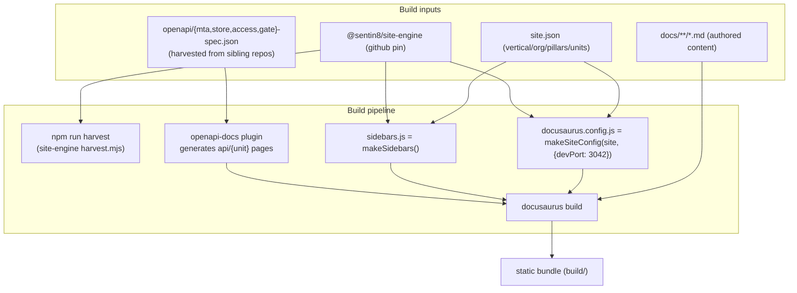
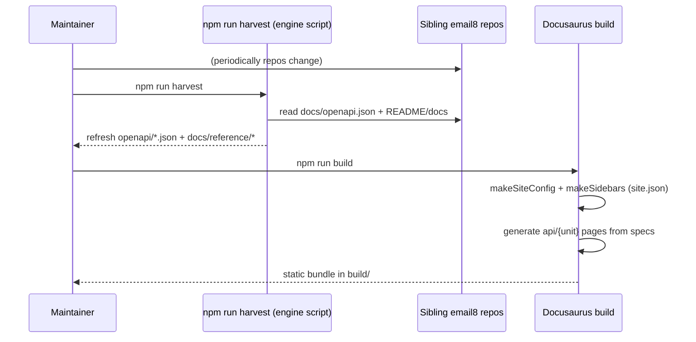
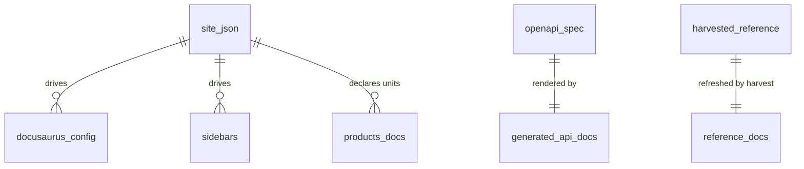
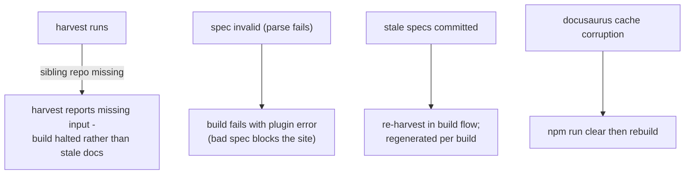
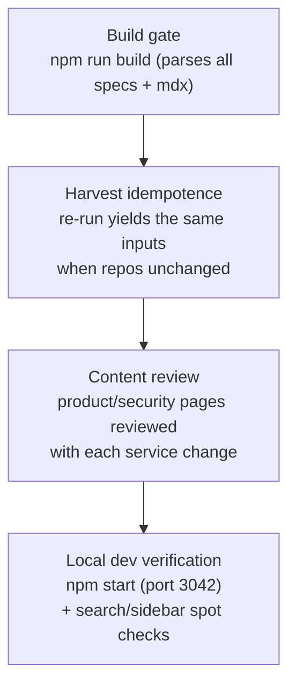

# Email8:Site - Detailed Design Document

## 1. Scope & Context

Email8:Site owns: the email8.dev static website source - the
declarative site descriptor (`site.json`), Docusaurus configuration,
docs content tree, harvested OpenAPI inputs, and the build pipeline
that turns all of it into the static bundle.

It does NOT own: any backend behavior, the design system (`@sentin8/site-engine`
provides it), the harvested specs (`docs/openapi.json` in each service
repo is the source of truth), or hosting.



Trust boundary: none at runtime (pure static content). The build-time
trust question is spec provenance - harvested specs come from sibling
repos' `docs/openapi.json`.

## 2. Runtime Architecture

There is no runtime server; the "components" are build-time factories
and content generators:

| Component | Responsibility |
|---|---|
| `site.json` | Single declarative descriptor: `vertical: email8`, `name`, `org: Email8-dev`, `domain: email8.dev`, tagline, `accent: #3E8FB0`, lead text, 5 pillars, `units[]` (mta/store/access/gate with kind/service, repo, org, summary, scopes like `email8:mta:queue:write`, `email8:store:mail:read`, `email8:access:imap:read`, `email8:gate:sessions:read`), `apps[]` (webmail), `sdks[]` (email8 Rust SDK), `showcase` (Sentin8 platform) |
| `docusaurus.config.js` | `makeSiteConfig(site, { devPort: 3042 })` from the engine - metadata, theme config, plugins (`openapi-docs`, mermaid, local search) |
| `sidebars.js` | `makeSidebars()` - navigation derived from `site.json` sections |
| `harvest` script | `node node_modules/@sentin8/site-engine/scripts/harvest.mjs .` - pulls sibling repo docs + OpenAPI specs into `docs/reference/*` and `openapi/*` |
| `docs/` content tree | authored + harvested mdx/md |
| Generated API pages | `docusaurus-plugin-openapi-docs` renders `docs/api/{unit}/` from `openapi/{unit}-spec.json` (per-endpoint `.api.mdx`, `RequestSchema.json`, `StatusCodes.json` such as `health.api.mdx`, `dispatch.api.mdx`, the `policy-*` set) |

**Content tree** (`docs/`):

```
docs/
├── index.md                     # landing + pillars
├── products/
│   ├── _category_.json
│   ├── mta/(index.md, security.md)
│   ├── store/(index.md, security.md)
│   ├── access/(index.md, security.md)
│   └── gate/(index.md, security.md)
├── apps/webmail/(index.md, security.md)
├── sdk/(index.md + sdk subpages)
├── developers/index.md
├── samples/index.md
├── security/index.md
├── reference/
│   ├── index.md
│   ├── mta/(index.md, overview.md, security.md)
│   ├── store/(…), access/(…), gate/(…)
│   ├── sdk/(…)
│   └── webmail/(…)
└── api/{mta,store,access,gate}/  # generated from openapi specs
```

**Build flow (docs generation family):**



## 3. Data Model

The site persists no data at runtime. Its "data model" is the content
contract files:

| Artifact | Shape | Rule |
|---|---|---|
| `site.json` | JSON (vertical, name, org, domain, tagline, accent, pillarsLead, pillars[], units[], apps[], sdks[], showcase) | single source driving config+sidebars |
| `openapi/{unit}-spec.json` | OpenAPI 3 (harvested) | build artifact - never hand-edited in the site |
| `docs/**/*.md(x)` | authored pages | frontmatter + engine conventions |
| generated `docs/api/**` | mdx + JSON fragments | regenerated per build from specs |



## 4. API Surface

No runtime API. The surface is the npm/Make interface:

| Command | Effect |
|---|---|
| `npm run harvest` | Refresh `docs/reference/*` + `openapi/*-spec.json` from sibling repos |
| `npm run build` | Produce the static bundle (regenerates API docs from current specs) |
| `npm run start` / `docusaurus start` | Dev server on port 3042 (`devPort`) |
| `npm run serve` | Serve the built bundle locally |
| `npm run clear` | Clear Docusaurus caches |
| `npm run swizzle` | Engine-component customization escape hatch |
| `npm run writeTranslations` / `writeHeadingIds` | i18n + anchors scaffolding |

**Consumed inputs** (build-time): sibling repos' `docs/openapi.json`
(mta/store/access/gate), sibling repo reference docs, the pinned site
engine.

**Events emitted:** none.

## 5. Cross-Cutting Concerns

- **Spec provenance**: harvested `openapi/*-spec.json` come from the
  sibling repos; the site treats them as immutable inputs - any
  API-doc bug is fixed upstream and re-harvested.
- **Declarative extensibility**: adding a unit means `site.json` +
  docs pages; `makeSiteConfig`/`makeSidebars` handle wiring (no
  config-code divergence).
- **Engine pinning**: the engine is pinned (`site-engine-v0.9.x`
  github source), so chrome/layout upgrades are deliberate.
- **Search**: `@easyops-cn/docusaurus-search-local` indexes the built
  pages (docs + generated API).
- **Mermaid**: diagrams in docs render via the mermaid theme config.
- **Branding**: accent/tagline/org flow from `site.json` into the
  engine chrome; no per-site style forks.

## 6. Failure Modes & Recovery



- Missing/invalid inputs fail loudly at build time - a published site
  always reflects a complete, parseable content set.
- Caches are disposable (`clear`); no persistent state to recover.

## 7. Concurrency & Performance Model

- Build is single-process (Docusaurus); harvest is sequential over
  units - content size is modest (four services + one app + one SDK).
- Generated API pages are the bulk of the output; they are re-rendered
  per build (cheap, deterministic).
- Hosted statically; page-serve performance is CDN-grade by nature.

## 8. Invariants, Insecure-Defaults Rejected, Unsafe Rationale

- Harvested OpenAPI files are never hand-edited in this repo.
- All layout/theme code lives in the pinned engine; site-level
  overrides only through documented escape hatches (`swizzle`).
- Marketing claims in `site.json` pillars map to shipped features.
- No backend, no secrets, no runtime endpoints - a compromised site
  build leaks nothing.
- Rejected defaults: divergent per-site theming forks, vendored spec
  edits, unversioned engine (`latest` unpinned).

## 9. Testing Strategy



- The build itself is the primary test: invalid specs, broken mdx, or
  sidebar drift fail the build.
- Content correctness is human-review-on-change (business docs, not
  unit-testable logic).

## 10. Open Questions

- Production hosting pipeline (CI publish target for the bundle).
- i18n scope (translation scaffolding exists; no locale set chosen).
- Automated doc-drift CI checks (build-time re-harvest covers it)
  with a diff-report surface for reviewers.

---

**Architecture & Design:** email8:site and its underlying concepts were designed by [Hamid Jahanzad](https://www.linkedin.com/in/hamidjahanzad/).