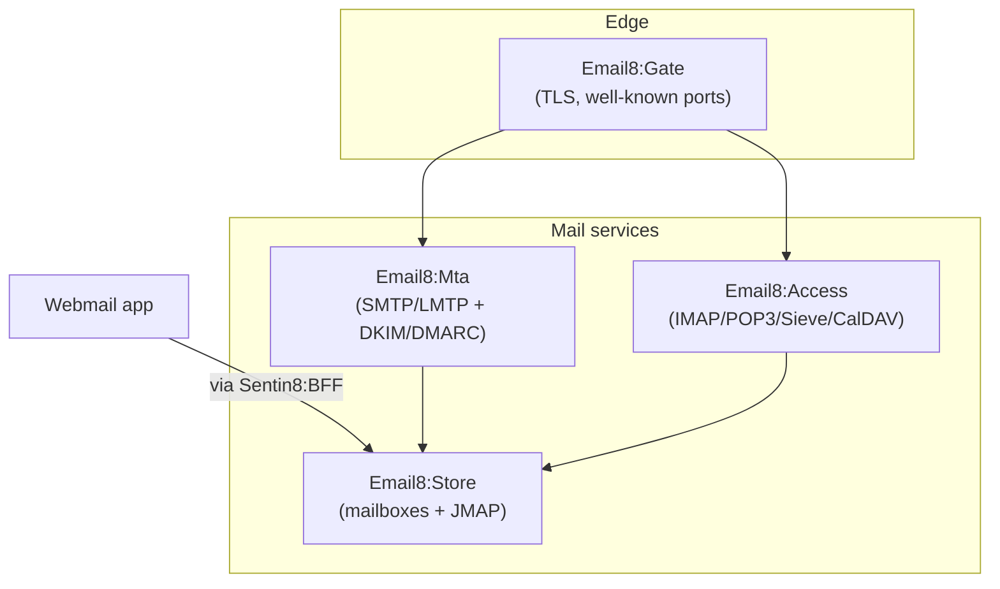

# Email8 - the email vertical

Email8 is a complete mail platform on Sentin8: an SMTP/LMTP
transfer engine with DKIM/DMARC, a mail & collaboration data core
with the JMAP API, full-protocol mailbox access (IMAP, POP3,
ManageSieve, CalDAV/CardDAV), and a TLS gate for the well-known
ports - plus the Webmail app.

## The products

| Product | Role |
|---|---|
| [Mta](/docs/products/mta) | SMTP/LMTP transfer - queue, DKIM, DMARC reports |
| [Store](/docs/products/store) | the data core - mailboxes, messages, JMAP |
| [Access](/docs/products/access) | mailbox protocols - IMAP, POP3, Sieve, CalDAV |
| [Gate](/docs/products/gate) | the TLS front door - well-known ports |

## Security

Email8 inherits the platform's five pillars and adds mail
guarantees: authenticated access on every protocol, DKIM-signed
outbound, and TLS-only listeners. Read the
[security page](/docs/security).