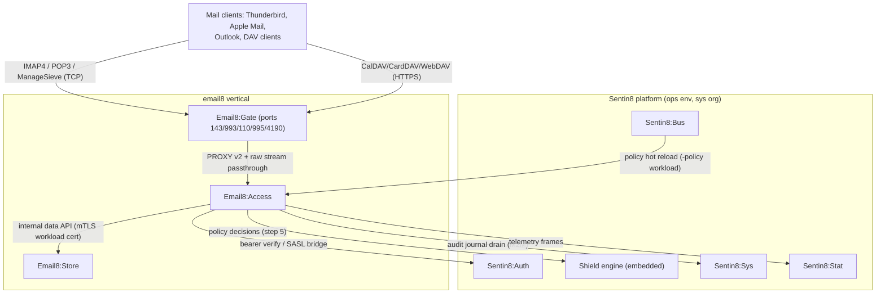
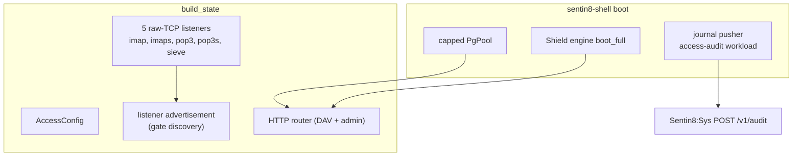
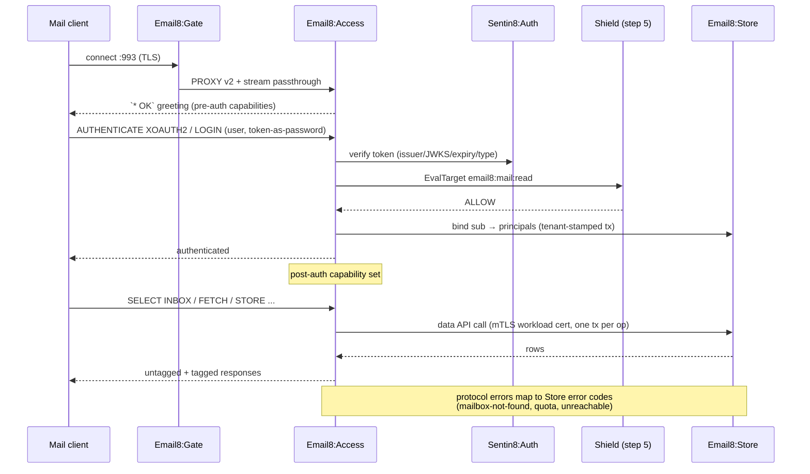
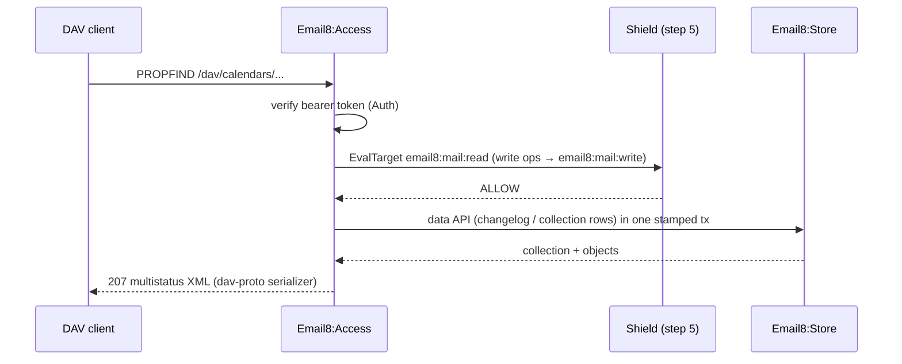
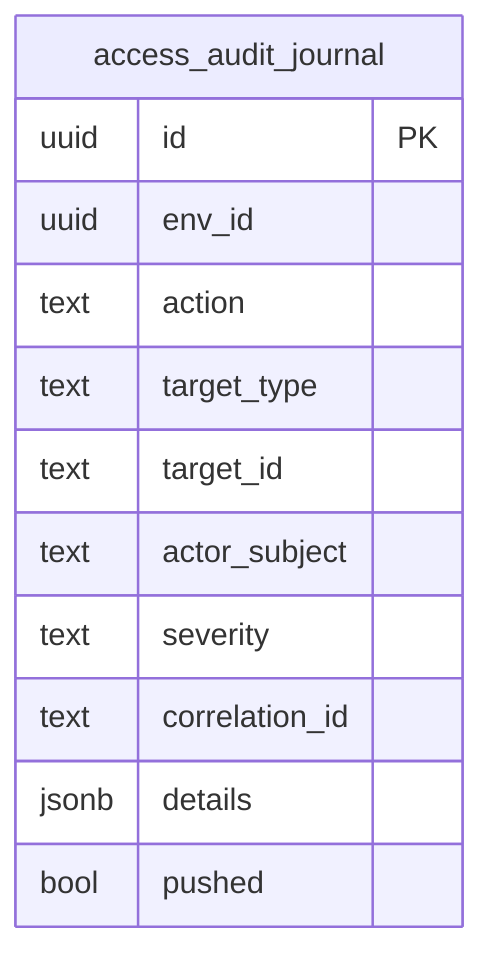
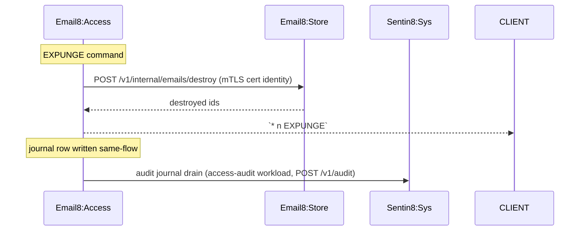
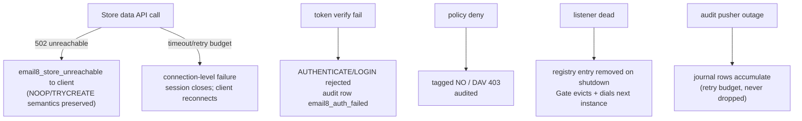
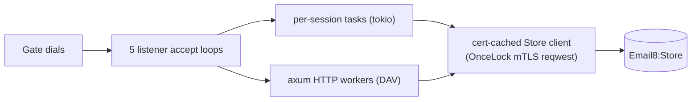
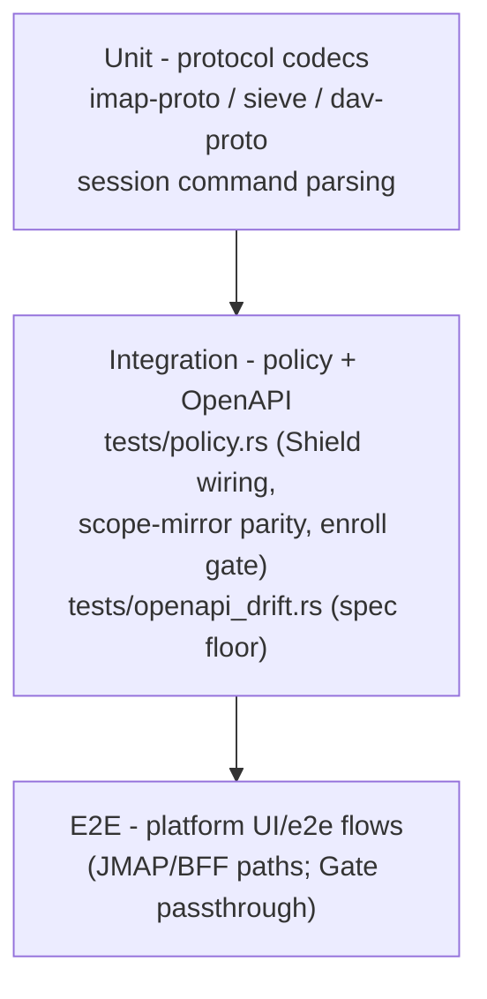

# Email8:Access - Detailed Design Document

## 1. Scope & Context

Email8:Access owns: the IMAP/POP3/ManageSieve session state machines,
the CalDAV/CardDAV/WebDAV HTTP dispatcher, credential verification and
account binding, and the leaf audit schema (`access.audit_journal`).

It does NOT own: any mail data (Email8:Store is the single writer),
client ports (Email8:Gate), message bytes (Sentin8:Storage),
authorization policy definitions (Shield), or identity (Sentin8:Auth).

Trust boundary note: mail clients are untrusted network peers; Access
treats the Gate-passthrough stream as client traffic and performs its
own credential verification end-to-end. The Store data API is a
machine-trust boundary crossed with the workload certificate only.

## 2. Runtime Architecture

Boot is shell-owned (`sentin8::shell::serve`, env prefix
`EMAIL8_ACCESS`): pool, Shield engine load (fail-closed), outbox relay
(n/a - no outbox rows are produced), audit-journal pusher (`access-audit`
workload), TLS identity. `build_state` adds Access wiring:

Listener set (per `server.rs`; port 0 = OS-ephemeral under the Gate):

| Listener | Well-known port | Transport |
|---|---|---|
| `imap` | 143 | plain TCP (or STARTTLS-capable), PROXY v2 consumed when `EMAIL8_ACCESS_ACCEPT_PROXY` |
| `imaps` | 993 | implicit PQ-TLS |
| `pop3` | 110 | plain TCP |
| `pop3s` | 995 | implicit PQ-TLS |
| `sieve` | 4190 | plain TCP (STARTTLS refused - TLS is listener-owned) |

**Protocol request lifecycle (IMAP family; POP3/Sieve are subsets of
the same pipeline):**

**DAV request lifecycle (HTTPS):**

## 3. Data Model

Access owns **no mail data tables** (`sql/init.sql` is a single
`SELECT 1` placeholder so `vertical init` finds a migration). The only
owned table is the leaf audit journal:

| Table | Purpose | RLS tier |
|---|---|---|
| `access.audit_journal` | Local audit journal (15-column AUDJOUR contract), drained to Sentin8:Sys `POST /v1/audit` by the shell's 8c pusher | env-scoped, ENABLE+FORCE RLS |

No state machines live here: mailbox state transitions are Store's
(changelog + UIDs), queue state is MTA's. Access only interprets them.

## 4. API Surface

### 4.1 TCP protocol listeners (client plane)

| Listener | Phase machine (`src/*_session.rs`) |
|---|---|
| IMAP (143/993) | greeting → pre-auth caps `IMAP4rev2, IMAP4rev1, ENABLE, SASL-IR, LITERAL+, ID, UTF8=ACCEPT, AUTH=XOAUTH2, AUTH=OAUTHBEARER, STARTTLS` → AUTHENTICATE/LOGIN (token bridge) → post-auth caps `IDLE, NAMESPACE, CHILDREN, MULTIAPPEND, BINARY, UNSELECT, UIDPLUS, ESEARCH, WITHIN, SEARCHRES, SORT, LIST-EXTENDED, LIST-STATUS, SPECIAL-USE, CREATE-SPECIAL-USE, MOVE, CONDSTORE, QRESYNC, STATUS=SIZE, OBJECTID, …` → command loop; `CAPABILITY`/`ENABLE`/`ID`/`NOOP`/`CHECK`/`LIST`/`LSUB`/`SELECT`/`EXAMINE`/`STATUS`/`CLOSE`/`UNSELECT`/`FETCH`/`STORE`/`SEARCH`/`SORT`/`THREAD`/`APPEND`/`COPY`/`MOVE`/`EXPUNGE`/`IDLE`; STARTTLS resets state in place (RFC 3207) |
| POP3 (110/995) | greeting → CAPA (`STLS, UIDL, TOP, USER, PIPELINING, UTF8, IMPLEMENTATION Email8`) → USER/PASS (PASS carries the token) → transaction (`LIST`/`UIDL`/`TOP`/`RETR`/`DELE`/`RSET`/`NOOP`) → QUIT applies the delete batch through Store; APOP rejected |
| ManageSieve (4190) | greeting advertises `SIEVE_EXTENSIONS` (fileinto, redirect, reject, keep, stop, discard, vacation, envelope, comparators, body, imap4flags, variables) → `AUTHENTICATE "XOAUTH2 OAUTHBEARER"` → `LISTSCRIPTS`/`PUTSCRIPT`/`SETACTIVE`/`GETSCRIPT`/`DELETESCRIPT`/`RENAMESCRIPT`/`CHECKSCRIPT`/`HAVESPACE` (compile check via the `email8::sieve` crate) |

### 4.2 HTTP API (DAV + ops)

| Method | Path | Gate | Purpose |
|---|---|---|---|
| GET | `/v1/health` | none | liveness (version/build) |
| ANY | `/dav`, `/dav/`, `/dav/{*path}` | bearer + Shield `email8:mail:read`/`:write` | CalDAV/CardDAV/WebDAV dispatcher: OPTIONS, PROPFIND (Depth 0/1), REPORT (calendar-query / addressbook-query / sync-collection), PROPPATCH, MKCOL, MKCALENDAR, GET, PUT, DELETE, COPY/MOVE, LOCK, UNLOCK, ACL |
| GET/POST | `/v1/admin/{*page}` | `email8:admin:imap`/`:sieve` | RFW admin pages `imap` (0xe873) and `sieve` (0xe0b9) |
| * | `/v1/admin/policy-sets…`, `/v1/admin/relations…`, `/v1/admin/attributes…` | platform policy admin | shared Shield admin surface |
| GET | `/v1/health` (spec'd) | none | OpenAPI-registered |

No CORS layer is installed on the DAV routes so WebDAV headers survive
(DAV clients are not browser origins).

**Error codes** (registered): `email8_store_unreachable` 502,
`email8_invalid_token` 401, `email8_insufficient_scopes` 403,
`email8_mailbox_not_found` 404, `email8_sieve_script_not_found` 404.

**Events emitted:** none (§Business 4). Audit actions land in the
journal; the Shield hot-reload consumer runs on the `email8:access-policy`
workload (`sentin8:bus:consume`, `sentin8:stat:measure`).

### 4.3 Store internal data API consumed (not exposed here)

| Endpoint (Email8:Store) | Used by |
|---|---|
| `POST /v1/internal/mailboxes` (list/create) | LIST/SELECT/CREATE |
| `GET /v1/internal/mailbox/emails` | FETCH/SEARCH/SORT rows |
| `POST /v1/internal/changes` | CONDSTORE/QRESYNC, IDLE wake, sync-collection |
| `POST /v1/internal/ingest/append` | APPEND, Sent filing |
| `POST /v1/internal/emails/destroy` | EXPUNGE, POP3 QUIT |
| `POST /v1/internal/emails/copy` | COPY/MOVE |
| `POST /v1/internal/email/keywords` | STORE flags/keywords |
| `GET /v1/internal/email/{env}/{account}/{id}` | body/structure fetch |
| `POST /v1/internal/sieve/{list,get,put,setactive,delete,rename}` | ManageSieve commands |
| `GET/POST /v1/internal/acl/{rights,grant,revoke}` | ACL / shared folders |
| calendar/contact/file equivalents over the data API | DAV dispatcher |

## 5. Cross-Cutting Concerns

- **Authentication**: token-first only - `decode_xoauth2` for
  XOAUTH2/OAUTHBEARER SASL, PLAIN bridged via credentials where enabled
  at the platform level, POP3 USER/PASS with the token in the PASS
  field; every verify re-binds `sub → principals.id` on a
  tenant-stamped connection.
- **Authorization**: embedded Shield engine, `scope-mirror` policy set
  in enforced mode; actions `email8:mail:read`/`email8:mail:write`;
  roles resolved LIVE per request (no `roles` claim).
- **Tenant isolation**: protocol sessions are bound to one account
  (`MailAuth{auth, account_id}`); every Store call carries that binding
  and Store stamps `app.account_id` transaction-locally.
- **Certificate identity (internal plane)**: the Store data client is
  an mTLS reqwest client presenting the `m2m-email8:access` workload
  certificate (certless M2M; no bearer token on that path).
- **Audit**: journal rows in the leaf schema, pushed by the shell
  pusher; failures retry on the journal, never drop.
- **TLS**: PQ TLS via `sentin8-tls` for implicit-TLS listeners and the
  HTTPS DAV surface; Gate terminates nothing - the Gate passes streams
  end-to-end.
- **Graceful drain**: listeners unpublish from the registry on
  shutdown; the Gate stops dialing the instance before connections
  drain during upgrades.

## 6. Failure Modes & Recovery

- Store outage: sessions degrade to explicit errors; no partial state
  is invented client-side.
- Gate/instance rotation: registry eviction plus 1s-TTL snapshots; new
  connections go to healthy instances.
- Audit-drain outage: journal persists locally; the pusher retries.

## 7. Concurrency & Performance Model

- One tokio task per protocol session; DAV rides axum's worker pool.
- Session idle timeout 30 minutes (IMAP) / connection timeout on POP3.
- The mTLS Store client is built once and shared; per-request state is
  limited to session buffers.
- Hot paths: FETCH/SEARCH batch reads against Store's indexed
  `(mailbox_id, imap_uid)` and `changelog` scans.

## 8. Invariants, Insecure-Defaults Rejected, Unsafe Rationale

- The service never writes mail data outside the Store data API; there
  is no second persistence path.
- A session is always bound to exactly one account; unbound requests
  are rejected, never defaulted.
- Token-based access only - no password storage, no APOP, no anonymous
  access paths.
- STARTTLS on Sieve is refused rather than double-TLS'd (listener owns
  TLS end-to-end).
- No `unsafe` code.
- Rejected defaults: silent unauthenticated fallbacks, header-based
  account override, in-memory mailbox caching that could diverge from
  Store's changelog.

## 9. Testing Strategy

- **Unit**: wire codecs and session parsers in the SDK crates
  (`email8-sdk`); session-level command dispatch covered by crate tests.
- **Integration**: the policy suite runs the real seeded Shield set
  (deny-without-set, forbid-beats-permit, M2M parity, platform-admin);
  the OpenAPI test guards spec drift (`docs/openapi.json`, ≥19 ops).
- **Deliberately not tested here**: Store's persistence semantics, MTA
  delivery, Gate byte-pumping internals - each is owned by its service's
  suite; platform transport layers are the platform's.

## 10. Open Questions

- IMAP metadata/annotations extensions (`METADATA`, `NOTIFY`) if client
  demand materializes.
- POP3 multi-folder projection (currently INBOX-only by design).
- DAV ACL write paths beyond read-only effective-rights (grants flow
  through Store's ACL endpoints today).

---

**Design attribution:** email8:access and its underlying concepts were designed by Hamid Jahanzad <Hamid@Jahanzad.com>.
