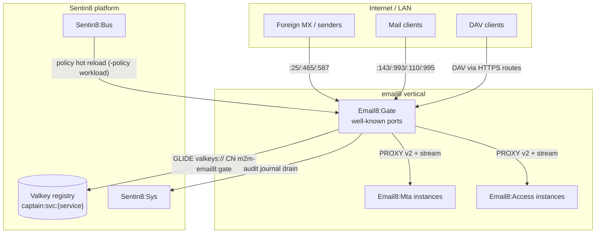
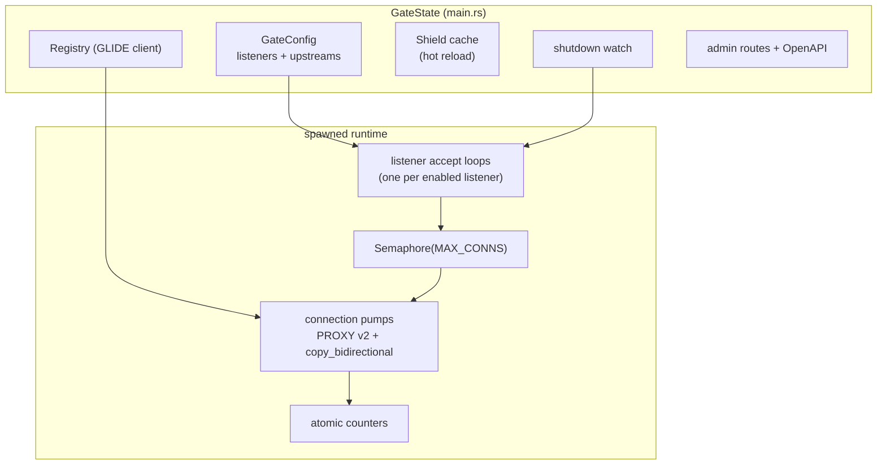
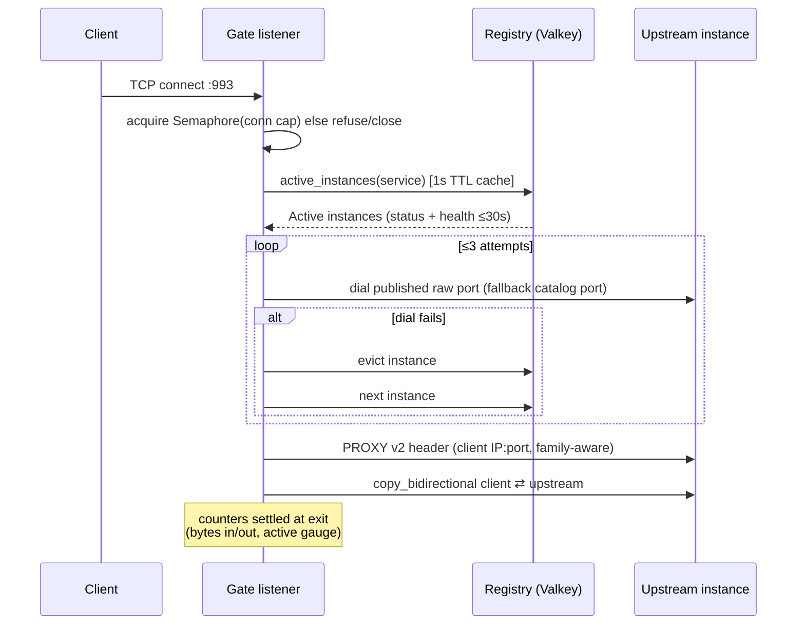
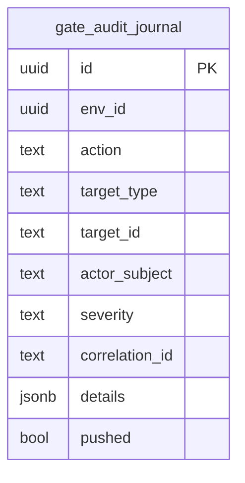
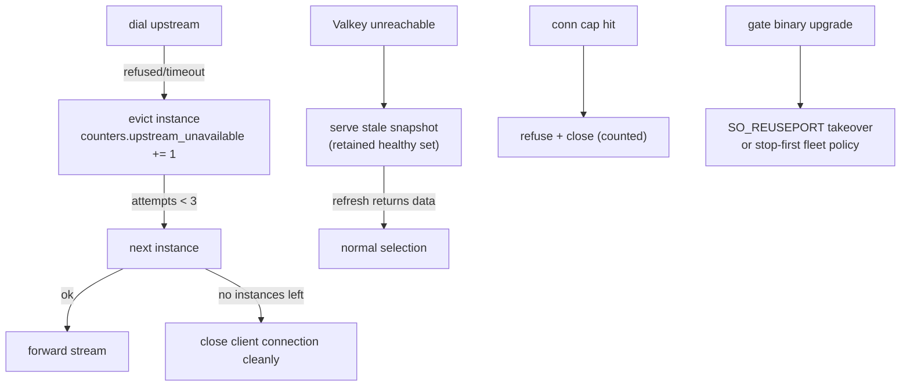
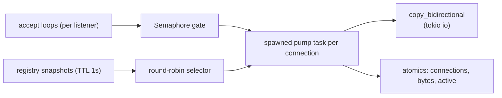
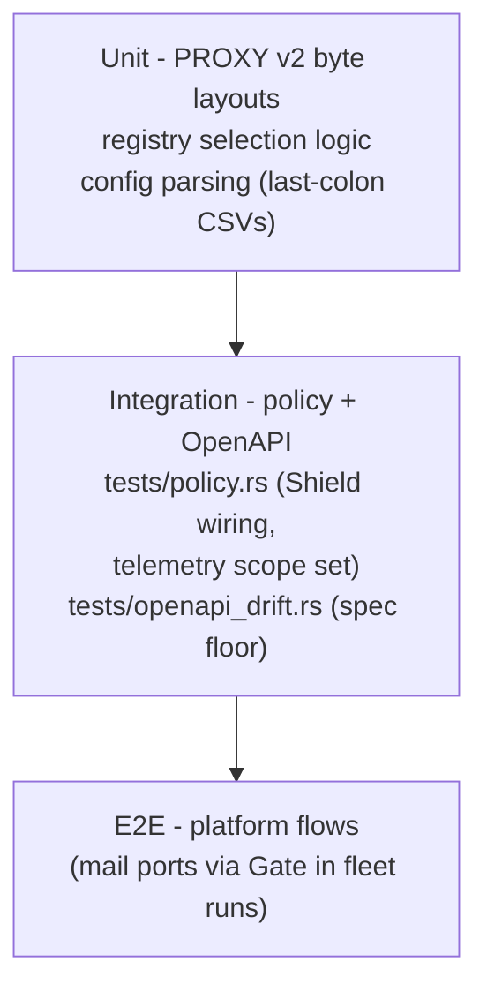

# Email8:Gate - Detailed Design Document

## 1. Scope & Context

Email8:Gate owns: the well-known mail port listener set
(25/465/587/143/993/110/995/4190), upstream instance discovery, PROXY
v2 header synthesis, byte-level passthrough, connection governance, and
its leaf audit schema (`gate.audit_journal`).

It does NOT own: any mail protocol state (Email8:Mta, Email8:Access),
TLS termination for implicit-TLS listeners (terminated in the backend
services via `sentin8-tls`), mail data, or any database beyond its
audit journal.

Trust boundaries: the Internet side is untrusted; the
Gate→backend plane is the fleet-internal network where the Gate is the
only component permitted to prepend PROXY v2 headers. The Valkey plane
is reached with the workload certificate identity.

## 2. Runtime Architecture

Boot is shell-owned (`Sentin8Shell::new("email8:gate", "EMAIL8_GATE")`);
the gate state carries NO database pool - the Shield engine is a fresh
in-memory cache fed by the hot-reload Bus consumer.

**Listener configuration** (`config.rs`; CSVs parsed on the last colon
so `email8:mta:smtp submission` → service `email8:mta`, listeners
`smtp|submission`):

| Listener | Well-known port (env) | Upstream service | Fallback raw port (`EMAIL8_GATE_{NAME}_UPSTREAM_PORT`) |
|---|---|---|---|
| smtp | 25 (`EMAIL8_GATE_SMTP_PORT`) | email8:mta | 2525 |
| submission | 587 (`EMAIL8_GATE_SUBMISSION_PORT`) | email8:mta | 3587 |
| submissions | 465 (`EMAIL8_GATE_SUBMISSIONS_PORT`) | email8:mta | 3465 |
| imap | 143 (`EMAIL8_GATE_IMAP_PORT`) | email8:access | 1143 |
| imaps | 993 (`EMAIL8_GATE_IMAPS_PORT`) | email8:access | 1993 |
| pop3 | 110 (`EMAIL8_GATE_POP3_PORT`) | email8:access | 1110 |
| pop3s | 995 (`EMAIL8_GATE_POP3S_PORT`) | email8:access | 1995 |
| sieve | 4190 (`EMAIL8_GATE_SIEVE_PORT`) | email8:access | 4190 |

An empty `EMAIL8_GATE_*_PORT` disables that listener.

**Connection lifecycle (the only request family):**

## 3. Data Model

Gate owns **no domain data**. SQL is limited to the audit skeleton:

| Table | Purpose | RLS tier |
|---|---|---|
| `gate.audit_journal` | Operational audit journal (AUDJOUR 15-column contract), drained to Sys `POST /v1/audit` | env-scoped, ENABLE+FORCE RLS |

Registry reads (Valkey) consume, never persist: keys
`captain:svc:{service_type}` (HASH field `{ip}:{port}` → JSON
`ServiceInstance` mirror: `{key, service_type, local_ip, local_port,
status}`) and each upstream's published raw-listener map.

## 4. API Surface

| Method | Path | Gate | Purpose |
|---|---|---|---|
| GET | `/v1/health` | none | liveness with build id/hash (captain probe fills the fleet VERSION) |
| GET | `/v1/gate/telemetry` | unauthenticated counters snapshot | ops probing |
| GET | `/v1/admin/ui/gate` | RFW UI definition (page `gate`, icon 0xe30a) | listener table + counter DataTables |
| POST | `/v1/admin/gate` | bearer + Shield `email8:gate:telemetry:read` | admin data endpoint (`/listeners`, `/counters`) |
| * | `/v1/admin/policy-sets…`, `/relations…`, `/attributes…` | platform policy admin | shared Shield admin surface |

**No mail-facing HTTP**: mail protocols arrive as raw TCP on the
listeners above and leave as raw TCP (plus one PROXY v2 header) to the
backend.

**Events emitted:** none. **Registered error codes:** none (clean TCP
refusals instead of HTTP errors).

## 5. Cross-Cutting Concerns

- **PROXY v2 is the contract** (`proxy_v2.rs`): v2_tcp4/v2_tcp6 byte
  layouts are unit-tested; mixed client/upstream families fall back to
  the TCP4 mapping rules. Backends (`EMAIL8_MTA_ACCEPT_PROXY`,
  `EMAIL8_ACCESS_ACCEPT_PROXY`) consume exactly one header before any
  protocol bytes - the Gate never sends protocol bytes first.
- **Instance selection** (`registry.rs`): GLIDE client via
  `sentin8::middleware::valkey_client(url, "email8:gate")` (TLS plane,
  cert CN → ACL user `m2m-email8:gate`); 1s TTL snapshot;
  `active_instances` filters `status="Active"` + health ≤30s,
  deterministically sorted; round-robin `next_instance`; failed dials
  `evict`; an empty refresh retains the stale set.
- **Connection governance** (`pump.rs`): optional
  `SO_REUSEPORT`+`SO_REUSEADDR` (when `EMAIL8_GATE_REUSE_PORT=true`)
  for zero-downtime gate upgrades; `Semaphore(EMAIL8_GATE_MAX_CONNS)`
  (default 2048) sheds overload with an immediate close; shutdown watch
  stops accept loops and drains pumps.
- **Authorization**: only the admin/telemetry surface is policy-gated
  (`scope-mirror` enforced for `email8:gate:telemetry:read`); mail
  traffic is deliberately un-gated here - policy lives in the protocol
  services.
- **Audit**: leaf journal pushed by the shell 8c pusher
  (`gate-audit` workload, `sentin8:sys:audit:write`).
- **Certificate identity**: the Valkey connection presents the
  `m2m-email8:gate` workload certificate; no secrets, no tokens stored.

## 6. Failure Modes & Recovery

- All-upstreams-down: connections refused fast (never hung) and
  counted; recovery is automatic when any instance goes Active.
- Registry outage: stale snapshot keeps healthy dials alive; evictions
  defer until refresh succeeds.
- In-flight connection during backend drain: the stream simply ends;
  clients reconnect (protocol-level reconnect is universal for mail).
- Audit/telemetry outage: counters are in-memory (reset on restart by
  design); journal retries.

## 7. Concurrency & Performance Model

- One spawned task per accepted connection; pumping is pure
  `copy_bidirectional` - no per-byte parsing, no buffering beyond the
  copy buffers.
- Counters are atomics (no locks); snapshot reads are free.
- Registry traffic is bounded: one snapshot cache per listener class
  refreshed lazily (1s TTL), independent per dial decision.
- Backpressure: the semaphore is the single admission control; refuse
  fast instead of queueing unbounded work.

## 8. Invariants, Insecure-Defaults Rejected, Unsafe Rationale

- The Gate never sends a protocol byte before the PROXY v2 header when
  the header is enabled; backends can rely on the framing.
- No parsing, interpretation, or transformation of mail protocol bytes
  ever occurs in the Gate.
- Dial targets are registry-derived only; hardcoded upstream endpoints
  are rejected defaults.
- Header byte layout is pinned by unit tests (v2_tcp4 / v2_tcp6).
- No `unsafe` code; no database access at runtime beyond the audit
  journal; no secrets beyond the Valkey workload identity.
- Rejected defaults: allowing unlimited concurrent connections, silent
  retry loops that mask backend outages, forwarding client-supplied
  PROXY headers (headers are synthesized fresh per connection).

## 9. Testing Strategy

- **Unit**: header encoders, listener-table parsing (empty port = disabled,
  CSV partition), registry refresh/eviction math.
- **Integration**: the Shield policy suite over the service's scope set;
  OpenAPI drift guard on `docs/openapi.json`.
- **Deliberately not tested here**: SMTP/IMAP semantics (owned by
  Mta/Access suites), Valkey server behavior (platform).

## 10. Open Questions

- Optional TLS termination at the Gate (centralized certificate
  handling) instead of backend-terminated implicit TLS.
- Edge filtering hooks (per-IP allowlists) if hostile-network
  scenarios demand them at the door rather than at protocol services.

---

**Architecture & Design:** email8:gate and its underlying concepts were designed by [Hamid Jahanzad](https://www.linkedin.com/in/hamidjahanzad/).
