# Email8:Mta - Detailed Design Document

## 1. Scope & Context

Email8:Mta owns: the SMTP/LMTP protocol listeners and session state
machines, the durable delivery queue (messages + per-recipient state
machine + due-event scan), quota buckets, DKIM rotation and signing,
the inbound screening pipeline (SPF/DKIM-verify/DMARC/spam tags/DNSBL/
greylist/rate-limits/hooks), outbound relay (MX/MTA-STS/DANE), report
generation (DMARC/TLS-RPT/external intake), the FTRL spam-training
worker, the mta leaf schema objects, and the `email8:smtp:*` /
`email8:spam:*` event production.

It does NOT own: mailbox persistence (Email8:Store), blob bytes
(Sentin8:Storage), credential issuance (Sentin8:Auth), client ports
(Email8:Gate), or scheduling of long-run jobs (Sentin8:Cron drives
DKIM rotation).

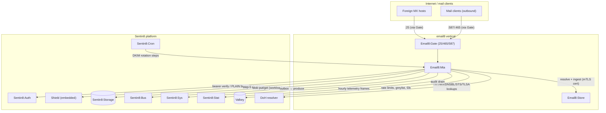

Trust boundary: the SMTP-facing side is hostile; every session is
rate-limited, greylisted, screened and audited. Internal edges (Store,
Storage, Bus) cross on certificate identity only.

## 2. Runtime Architecture

Boot is shell-owned (`Sentin8Shell::new("email8:mta","EMAIL8_MTA")`):
pool + Shield engine + outbox relay (8b, channel `mta_outbox_changed`)
+ audit pusher (8c, `mta-audit` workload).

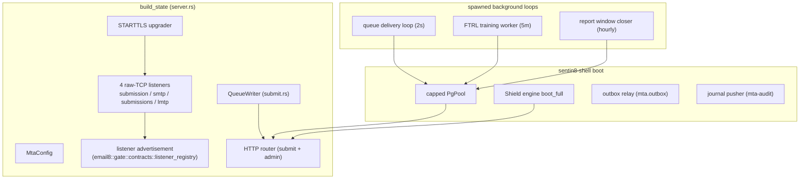

**Listener set** (per `server.rs`; OS-ephemeral under the Gate unless a
positive port pins dev direct-bind):

| Listener | Well-known port | Role |
|---|---|---|
| `submission` | 587 | authenticated user send-off |
| `smtp` | 25 | inbound MX reception |
| `submissions` | 465 | implicit-TLS submission |
| `lmtp` | 24 | platform-internal local delivery dialogue |

**Inbound SMTP session lifecycle (submission; reception differs only
in auth gating):**

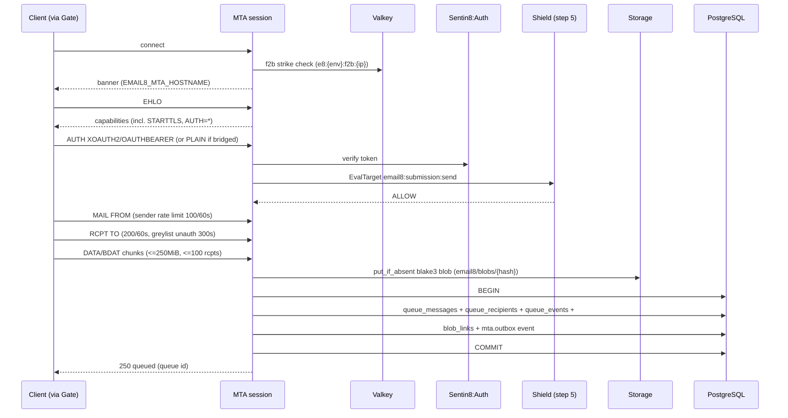

**End-of-DATA pipeline (pipeline.rs; the screening order is policy):**

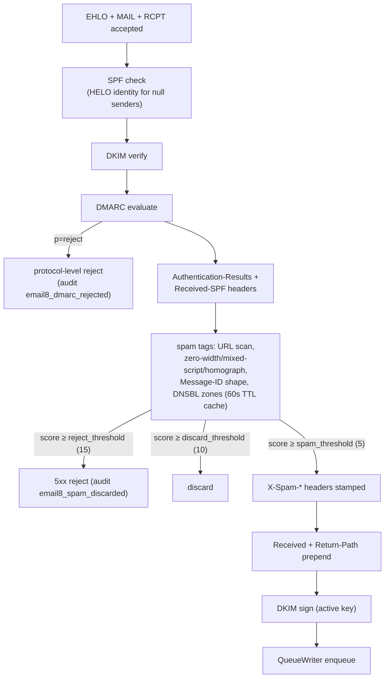

**Delivery loop (queue.rs):**

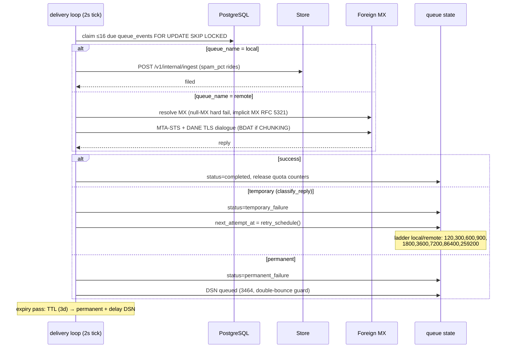

## 3. Data Model

Tables live in the shared `email8` schema; producer tables
(`mta.outbox`, `mta.audit_journal`) live in the service leaf schema,
which leads the service role's `search_path`.

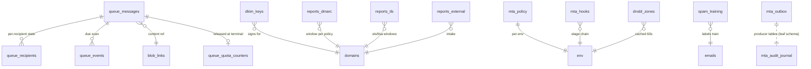

| Table | Key columns | Purpose |
|---|---|---|
| `email8.queue_messages` | id, env_id, return_path, blob_hash, size, priority, source_flags, expires_at, metadata JSONB | Enqueued message pointer (bytes in Storage) |
| `email8.queue_recipients` | id, message_id CASCADE, address, orcpt, queue_name CHECK('local','remote','dsn','report'), status CHECK('scheduled','completed','permanent_failure','temporary_failure'), notify_flags, attempts, spam_pct, next_attempt_at, next_notify_at, last_reply, dsn_sent_at | Per-recipient state machine (the retry contract) |
| `email8.queue_events` | id, message_id, queue_name, kind CHECK('delivery','dsn','expiry'), due_at, claimed_at, claimed_by; partial idx `(env_id,due_at) WHERE claimed_at IS NULL` | Claiming surface (SKIP LOCKED) |
| `email8.queue_quota_counters` | PK (env_id,bucket_kind,bucket_key), used_bytes, used_count | Sender/rcpt/rcpt-domain quota buckets |
| `email8.dkim_keys` | id, env_id, domain, selector, algorithm CHECK('rsa-sha256','ed25519'), stage CHECK('pending','active','retiring','retired'), secret_ref, next_transition; UNIQUE(env,domain,selector) | DKIM rotation state (secret references only) |
| `email8.reports_dmarc` | env_id, domain, policy_hash, window_start/end, rows JSONB; UNIQUE(env,domain,policy_hash,window_end) | DMARC aggregate windows |
| `email8.reports_tls` | env_id, domain, policy_type CHECK('sts','tlsa'), policy_hash, windows, rows | TLS-RPT windows |
| `email8.reports_external` | env_id, report_kind CHECK('dmarc','tls','arf'), domain, payload JSONB, source_address | Inbound report intake |
| `email8.mta_policy` | env_id PK, hostname, max_message_size (25MB), max_recipients_per_message (100), max_messages_per_session (10), require_auth, allow_relaying, dsn_name/address | Env SMTP policy |
| `email8.mta_hooks` | env_id, stage CHECK('connect','ehlo','mail','rcpt','data'), hook_kind CHECK('sieve','milter','http'), target, config, is_enabled; UNIQUE(env,stage,hook_kind,target) | Hook chain config |
| `email8.spam_training` | env_id, account_id, email_id, label BOOLEAN, trained_at; partial pending idx | FTRL worker input |
| `email8.dnsbl_zones` (owned by Store) | PK (env_id,zone), scopes, max_checks | Zone config the MTA caches 60s |
| `mta.outbox` (leaf) | id, env_id, event_type, stream_family, payload, relayed, relay_attempts, next_retry_at | Local outbox (DBX) |
| `mta.audit_journal` (leaf) | 15-column AUDJOUR contract | Audit journal (drained by 8c) |

**Recipient state machine:**

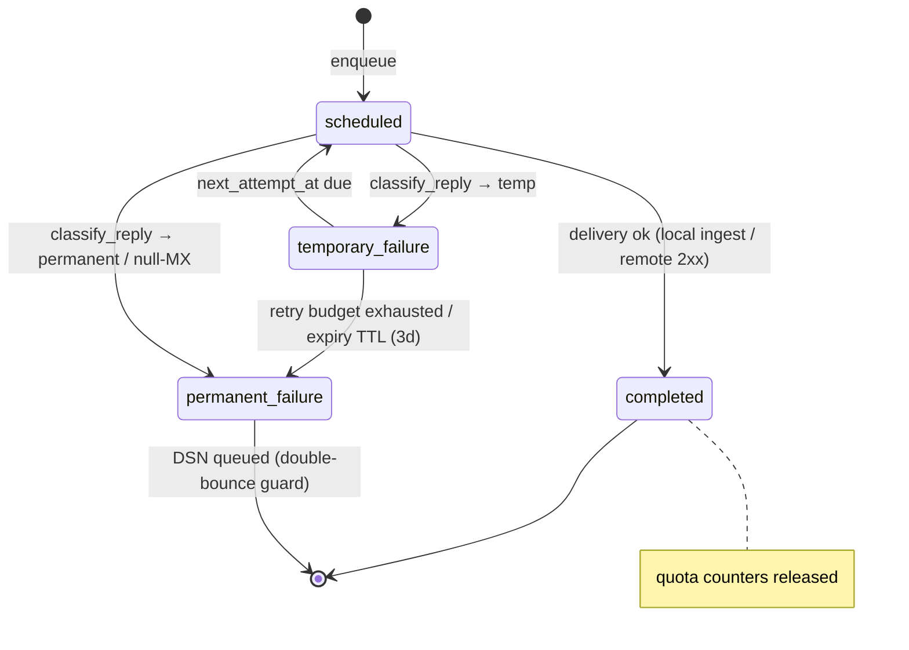

RLS: every tenant table ENABLE+FORCE with `env_id = sentin8_current_env_id()`;
grants to `email8_mta_service` (no bypass).

## 4. API Surface

### 4.1 HTTP (server.rs routes)

| Method | Path | Gate | Purpose |
|---|---|---|---|
| GET | `/v1/health` | none | liveness |
| POST | `/v1/internal/submit` | user bearer re-verified + Shield `email8:submission:send` (env match) | JMAP submission handoff from Store: fetch blob from Storage, enqueue |
| GET/POST | `/v1/admin/{*page}` | Shield `email8:admin:queue` etc. | RFW pages `queue`(0xe8d3), `dkim`(0xe068), `reports`(0xe873), `spam`(0xe868), `hooks`(0xe8e1), `domains`(0xe80b); `target_env_id` on data |
| * | `/v1/admin/policy-sets…`, `/v1/admin/relations…`, `/v1/admin/attributes…` | platform policy admin | shared Shield admin surface |

SMTP/LMTP listeners are raw TCP (§2); the Gate fronts 25/465/587 while
24 (LMTP) is platform-internal.

**Error codes** (registered): `email8_dmarc_policy_reject` 422,
`email8_spam_score_reject` 422, `email8_greylisted` 429,
`email8_queue_full` 402, `email8_relay_denied` 403,
`email8_sender_address_rejected` 403, `email8_dkim_key_not_found` 404,
`email8_domain_not_found` 404.

### 4.2 Event catalog (DBX producer path)

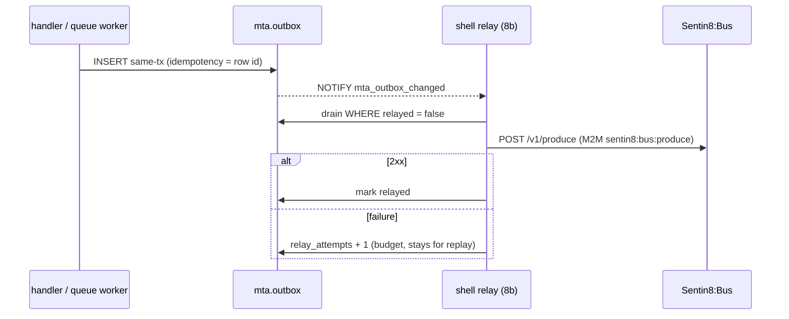

| Event | Trigger | Payload |
|---|---|---|
| `email8:smtp:message:received` | enqueue | `{queue_id, return_path, recipients[], blob_hash, size, source_flags}` |
| `email8:smtp:dsn:generated` | DSN queued | `{queue_id, dsn_queue_id, recipient, reply}` |
| `email8:smtp:message:expired` | TTL expiry | `{queue_id, recipients[]}` |
| `email8:spam:model:updated` | FTRL pass done | `{env_id, account_id, artifact_ref}` |

**Audited actions**: `email8_auth_failed`, `email8_rate_limited`,
`email8_relay_denied`, `email8_dmarc_rejected`,
`email8_spam_discarded`, `email8_admin_mutation` (+ journal drain to
Sys).

## 5. Cross-Cutting Concerns

- **Auth**: XOAuth2/OAuthBearer decode → Sentin8:Auth bearer verify →
  Shield `EvalTarget("email8:submission:send")`; PLAIN is bridged
  to the platform OAuth password grant at `{issuer}/oauth/token` and
  exists only when `EMAIL8_SASL_BRIDGE=on`.
- **Rate limiting / greylist** (`valkey_limits.rs`): fixed windows
  `e8:{env}:{kind}:{key}:{window}` per `ThrottleKind`
  (Connection/Sender/Rcpt/RcptDomain/RemoteHost/RemoteIp/Ehlo/
  AuthenticatedAs); greylist `e8:{env}:grey:{ip}:{sender}:{rcpt}` SET
  NX TTL; f2b `e8:{env}:f2b:{ip}` 3 strikes/60s → 1h ban. The `e8:*`
  key namespace is provisioned to the service ACL via the enroll
  fragment's `valkey` section.
- **Tenant/RLS**: every stamped sequence runs in ONE transaction on
  ONE connection (`sentin8_current_env_id()` transaction-local);
  `dnsbl_config.rs` and `telemetry.rs` audit inserts follow the same
  rule.
- **Certificate identity (internal plane)**: `storage_auth.rs` builds
  the mTLS Storage/Store clients presenting the `m2m-email8:mta`
  workload certificate (CERTFREE-4V; no bearer token on internal
  paths). Registered workloads: `email8:mta` (produce, mail
  read/write/receive), `email8:mta-policy` (bus consume, stat
  measure), `mta-audit` (sys audit write).
- **Idempotency**: blob `put_if_absent` is content-hash idempotent;
  queue claiming is SKIP LOCKED so exactly one worker owns a due
  event; event production reuses the outbox row id as idempotency key.
- **TLS**: STARTTLS upgrades in place with RFC 3207 state reset
  (built from `sentin8::tls`, PQ); submissions (465) implicit TLS;
  outbound uses DANE verifier (DANE-TA/DANE-EE over webpki roots) and
  MTA-STS (STSv1 parse, mode cache by `_mta-sts` id).
- **Graceful drain**: listeners unpublish on shutdown; the relay and
  training/window loops are shell-managed tasks.

## 6. Failure Modes & Recovery

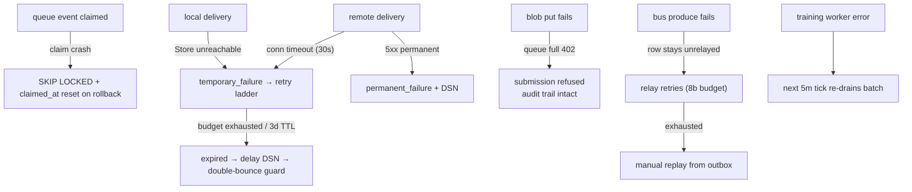

- Crash mid-transaction: enqueue tx (messages+recipients+events+blob
  links+outbox) is atomic - either all rows or none.
- Store outage: deliveries degrade to temporary failures on the ladder
  (retry contract holds); submission is unaffected while Storage
  answers.
- DNS outage: resolver paths (SPF/DKIM-verify/DMARC/DNSBL/MX) fail
  conservative - screening errors do not silently pass mail.
- Audit/outbox drain outage: local tables persist rows; pushers retry
  with budget; nothing is dropped.

## 7. Concurrency & Performance Model

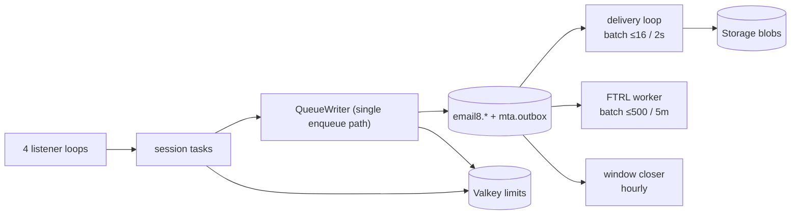

- One session task per SMTP connection; session caps: 15-min timeout,
  250 MiB transfer, 100 recipients, 10 messages per session
  (policy-controlled).
- Delivery loop claims bounded batches (≤16) with SKIP LOCKED; the
  claiming index `(env_id, due_at) WHERE claimed_at IS NULL` keeps the
  scan O(due).
- Blob writes are content-addressed (`put_if_absent`) - dedupe turns
  duplicate content into a no-op.
- Valkey counters are fixed-window atomics (no locks on the hot path).
- Spam-tag evaluation caches DNSBL zones per env for 60s; TXT
  resolution rides DoH with token-gated access.

## 8. Invariants, Insecure-Defaults Rejected, Unsafe Rationale

- Once committed, a queued message either delivers or expires with a
  DSN within the 3-day TTL - never vanishes.
- Recipient status transitions are one-way to terminal states; quota
  counters are always released at terminal states.
- Relaying requires policy allowance per domain (`allow_relaying` or
  hosted-domain match) - unauthenticated relay is refused by default.
- DKIM key material only by secret reference; plaintext secrets never
  enter storage.
- DMARC `p=reject` and the spam reject threshold are enforced before
  any filing.
- No `unsafe` code.
- Rejected defaults: accepting DATA before authentication on
  submission, disabling greylisting globally, bypassing the hook chain
  on protocol errors, silent `let _ =` on audit/outbox writes.

## 9. Testing Strategy

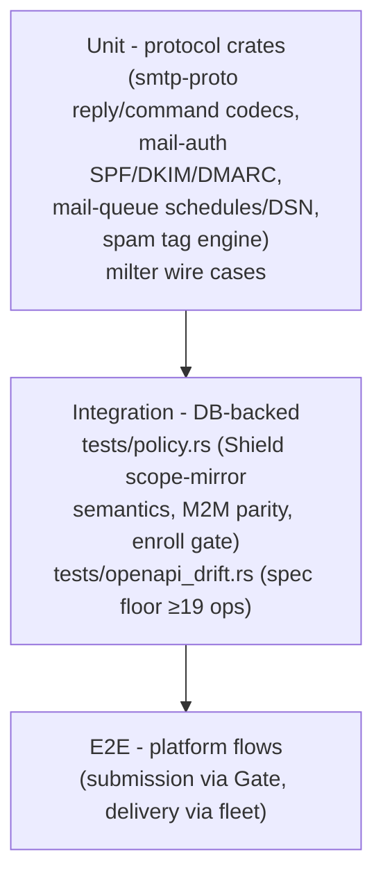

- The mail-auth/mail-queue/spam crates are pure-function tested with
  injected `DnsTxt` resolvers, so protocol math is covered without
  network.
- Policy suite runs the real seeded Shield sets (no-set → deny,
  forbid-beats-permit, shadow never blocks, platform-admin parity).
- Deliberately not tested here: Store filing semantics, Gate
  passthrough, TLS handshakes (platform layers).

## 10. Open Questions

- hickory DNSSEC validation upstream gap (DoH path today).
- Queue reprioritization admin action (data model supports priority).
- Additional milter extensions beyond the SMFIC v2/v6 subset in use.

---

**Architecture & Design:** email8:mta and its underlying concepts were designed by [Hamid Jahanzad](https://www.linkedin.com/in/hamidjahanzad/).
