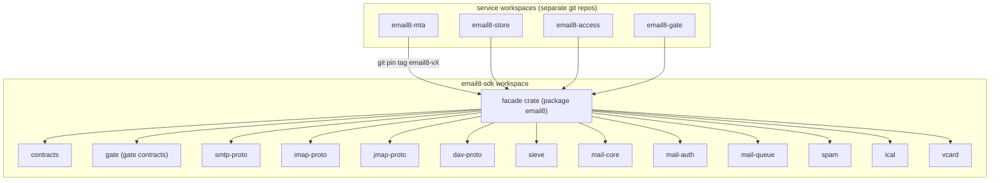
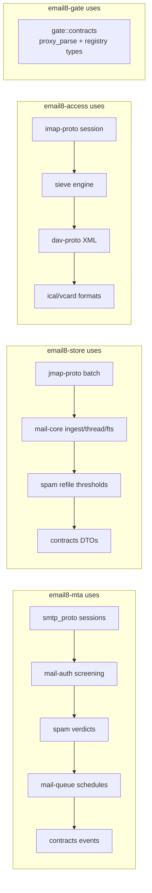
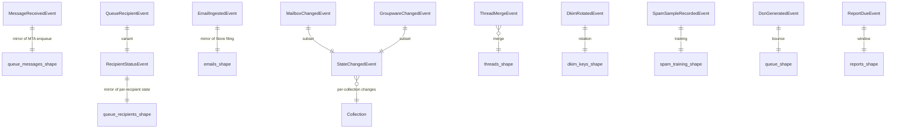
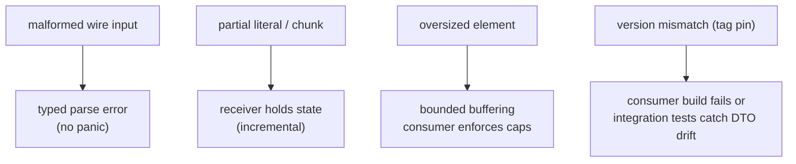
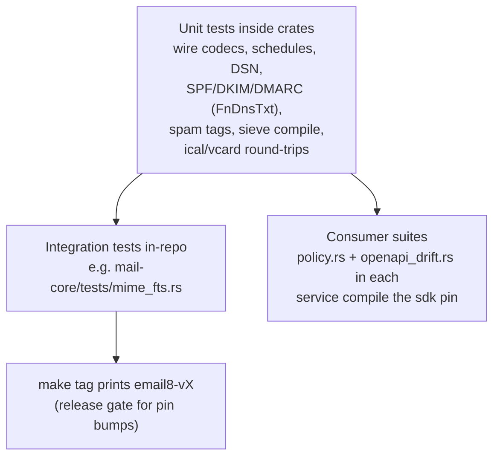

# Email8:SDK - Detailed Design Document

## 1. Scope & Context

Email8:SDK owns: the vertical's shared Rust contracts and engines -
protocol codecs, mail semantics, queue math, spam scoring, groupware
formats, gate contracts - and the namespace facade. It is a **library
workspace only**: it runs nothing, listens on nothing, stores
nothing.

It does NOT own: service wiring (each service repo), platform
machinery (the separate `sentin8` pin), or any persistence.

Dependency direction is strictly downward - the sdk never depends on a
service; library crates inside the workspace may depend on siblings
(the facade is the only outward surface).

## 2. Runtime Architecture

There is no runtime; the "architecture" is the crate graph and the
internal module responsibilities:

| Crate (package) | Modules | Responsibility |
|---|---|---|
| `facade` (package **`email8`**) | `src/lib.rs` | re-exports: `contracts`, `gate::contracts`, `dav_proto`, `imap_proto`, `jmap_proto`, `smtp_proto`, `mail_auth`, `mail_core`, `mail_queue`, `sieve`, `spam`, `ical`, `vcard` |
| `crates/contracts` (`email8-contracts`) | `events.rs`, `enums.rs`, `queue.rs`, `store_api.rs`, `errors.rs` | shared vocabulary (pure serde): event payload structs, `Collection`, `Acl` (16-bit rights READ→MODIFY_RSVP), `SpecialUse` (INBOX_ID=0, TRASH=1, JUNK=2, DRAFTS=3, SENT=4, ARCHIVE=5), `RecipientStatus`, `QueueName::{Local,Remote,Dsn,Report}` with `retry_schedule()` (local/remote `[120,300,600,900,1800,3600,7200,86400,259200]`; dsn `[900,1800,3600,7200]`; report `[1800,3600,7200]`), `notify_schedule()`, `expiry_ttl()` (3 days), `DkimStage`, `message_source` flags (AUTHENTICATED/UNAUTHENTICATED/DMARC_PASS/AUTOGENERATED/DSN/REPORT/VACATION); `store_api.rs` DTOs (`ResolveAddressRequest`, `ResolvedAddress::{Account,Group,External}`, `MailboxDto`, `CreateMailboxRequest`, `IngestMessage`, `IngestedEmail`, `MailboxUid`, `ChangesSince{Request,Response}`, `SubmitRequest`, `SubmitResponse`, `BlobQuota{Check,Verdict}`) |
| `crates/gate` (`email8-gate-contracts`) | `listener_registry.rs`, `proxy_parse.rs` | `publish()` / `spawn_unpublish_on_shutdown()` (services advertise raw listeners in Valkey for gate discovery); `parse_v2_header`, `accept_proxy_from_env`, `ProxyV2Error`; `BoundListener{proto,port,implicit_tls}` |
| `crates/smtp-proto` | `receiver.rs`, `command.rs`, `reply.rs` | SMTP/LMTP codec: `Receiver` (`Command`/`DataChunk` elements, `begin_data`), `Command` (incl. BDAT/STARTTLS/LHLO), `Reply` with enhanced status helpers (`need_ehlo`, `rate_limited`, `auth_failed`, `starttls_ready`, `transfer_quota`, `queue_full`, `auth_required`, `too_many_recipients`, `ehlo`) |
| `crates/imap-proto` | `receiver.rs`, `command.rs`, `response.rs` | IMAP4rev2 server-role wire codec: literal-aware incremental `Receiver`, typed `Command`/`Op`/`FetchItem`/`StoreItem`/`SequenceSet`, capability constants, tagged/untagged response builders |
| `crates/jmap-proto` | `request.rs`, `response.rs`, `capability.rs` | RFC 8620 shapes: `JmapRequest`/`JmapResponse`, `MethodCall::split`, `capability_for_method`, `resolve_references`, `RequestError`, urn constants (CORE/MAIL/SUBMISSION/VACATION_RESPONSE/SIEVE/BLOB/QUOTA), `echo` |
| `crates/dav-proto` | `xml.rs`, `lib.rs` | hand-rolled DAV XML: PROPFIND/PROPPATCH/REPORT parsing, multistatus builders, ETag/lock-token utils, `Depth::parse` |
| `crates/sieve` | `compiler.rs`, `interpreter.rs`, `lib.rs` | RFC 5228 compiler + interpreter; `SIEVE_EXTENSIONS` = fileinto, redirect, reject, keep, stop, discard, vacation, envelope, comparator-i;ascii-casemap, comparator-i;ascii-numeric, body, imap4flags, variables; actions collected, no I/O |
| `crates/mail-core` | `message.rs`, `mime.rs`, `fts.rs`, `threading.rs` | RFC 5322/MIME parsing, envelope/preview, `detect_tsvector_lang`, `thread_key`, `walk_parts`, `calendar_bodies` |
| `crates/mail-auth` | `spf.rs`, `dkim.rs`, `dmarc.rs`, `auth_results.rs`, `arc.rs` | SPF/DKIM/DMARC/AR/ARC engines over injected `DnsTxt` trait: `spf_check`, `dkim_verify`/`dkim_sign` (`DkimKey::{Ed25519,Rsa2048}`), `dmarc_lookup`/`dmarc_evaluate`, `build_results`, `received_spf`; `FnDnsTxt` test hook |
| `crates/mail-queue` | `schedule.rs`, `dsn.rs` | `classify_reply` → Class, retry/notify/expiry schedule math, RFC 3464 `build_dsn` (`DsnType::{Failure,Delay}`, `DsnRecipient`) |
| `crates/spam` | `rules.rs`, `url.rs`, `dnsbl.rs`, `classifier.rs` | `TagSet`, `TagThresholds` (injectable per-env weights), `evaluate_tags`, `SpamVerdict`, `SpamReport` (X-Spam-Status/Score/Result), `scan_urls` (IP-literal, zero-width, mixed-script, homograph), `check_dnsbl`/`DnsblZone`/`zones_from_config`, FTRL (`Features`, `FtrlModel`, `classify`) |
| `crates/ical` | `lib.rs` | RFC 5545 parse/build + RRULE expansion (FREQ/INTERVAL/COUNT/UNTIL/BYDAY, EXDATE), VEVENT+VTODO subset |
| `crates/vcard` | `lib.rs` | RFC 6350 parse/build (FN, N, EMAIL+TYPE, ORG, TEL, NOTE, ADR) |

**Engine dependency flow (how services compose the pieces):**

## 3. Data Model

No data ownership. The crate that most touches data *contracts* is
`contracts`; its type inventory is the sdk's de-facto data model:

(The `*_shape` entities are documentation stand-ins for the producing
tables; the sdk itself stores nothing.) Key typed vocabularies:

- `Collection` - shared numbering for mail/mailbox/etc. so changelog,
  JMAP changes, and DAV sync agree on collection ids.
- `Acl` - 16 documented bit rights (READ → MODIFY_RSVP) encoding the
  shared-mailbox permission model.
- `SpecialUse` - the bootstrap folder ids/roles (fixed by platform
  convention).
- `QueueName` + schedules - the delivery SLA ladder as code.

## 4. API Surface

The sdk's "API surface" is the façade re-export set plus the contracts
consumers bind to. No HTTP endpoints, no events emitted.

### 4.1 Facade import surface

| Import | Consumer usage |
|---|---|
| `email8::smtp_proto` | MTA session codec |
| `email8::imap_proto` | Access session codec |
| `email8::jmap_proto` | Store JMAP parsing |
| `email8::dav_proto` | Access DAV dispatcher |
| `email8::sieve` | Access ManageSieve compile checks; MTA hook scripts |
| `email8::mail_core` | Store ingest, MTA pipeline parsing |
| `email8::mail_auth` | MTA screening (SPF/DKIM/DMARC/ARC) |
| `email8::mail_queue` | MTA queue math, DSN generation |
| `email8::spam` | MTA verdicts; Store refile thresholds; training model |
| `email8::contracts` | all services: events, enums, DTOs, errors, schedules |
| `email8::gate::contracts` | MTA/Access listener advertisement; Gate PROXY parsing |
| `email8::ical` / `email8::vcard` | Store groupware; Access DAV payloads |

### 4.2 Contract pins (what consumers must keep true)

- Event structs serialize/deserialize stably (serde round-trip tests).
- `retry_schedule()` values are business SLAs - changing them is a
  versioned contract change.
- `store_api` DTOs mirror the live handlers in `email8-store`
  (`data_api.rs`); drift either way is a defect caught by integration
  tests.
- Gate PROXY v2 parsing matches the Gate's `proxy_v2` writer byte
  layouts (unit-tested on both ends).

## 5. Cross-Cutting Concerns

- **Error discipline**: codecs return typed errors (no panics on
  malformed bytes); malformed input degrades to protocol-level
  rejection at the consumer.
- **I/O injection**: DNS-dependent engines take `DnsTxt`/resolver
  traits; engines are pure otherwise - testable without networks.
- **Serde-first contracts**: event/DTO shapes are plain serde structs -
  stable naming, JSONB-friendly payloads for outbox rows.
- **No platform leakage**: the sdk does not import the `sentin8`
  facade; services bridge platform types at their own edges.
- **Docs standard**: crate-level `//!` big-picture docs; public items
  documented per the platform documentation standard (`#[deny(missing_docs)]`
  spirit).

## 6. Failure Modes & Recovery

As a library, failure modes are consumer-visible contract behaviors:

- Recovery is the consumer's protocol action (reply 5xx / close
  session / temp-fail); the sdk guarantees type-safe refusal points.
- Contract evolution is guarded by pins: Git tags + lockfile hashes +
  integration suites on the consumer side.

## 7. Concurrency & Performance Model

- All types are `Send`/non-owning where practical; codecs are per-
  session objects - one receiver per connection, no shared state.
- Incremental receivers stream-parse (literal-aware for IMAP, chunked
  DATA/BDAT for SMTP) without whole-message buffering until the
  consumer asks.
- FTRL/scoring paths are allocation-conscious (feature vectors reused
  by callers); schedule math is constant-time table lookups.
- No locks, no async runtime dependency inside leaf crates where
  avoidable - consumers choose the executor.

## 8. Invariants, Insecure-Defaults Rejected, Unsafe Rationale

- No `unsafe` code anywhere in the workspace.
- Wire codecs never panic on malformed input (typed errors only).
- Schedules/threshold constants are the single source of truth -
  no consumer-side hardcoding of retry ladders or threshold numbers.
- Facade-only external imports (leaf crates are workspace-internal).
- Rejected defaults: embedding DNS or network clients in engines,
  shared mutable global state (e.g. a process-wide model), lossy
  serde renames on event fields.

## 9. Testing Strategy

- Round-trip property tests on serde shapes.
- Engine tests use injected resolvers (`FnDnsTxt`) to cover RFC edge
  cases deterministically.
- Consumer integration suites are the cross-check: policy sets,
  OpenAPI floors, handler/DTO pairing.

## 10. Open Questions

- Publication strategy (crates.io/private registry) if external
  consumers appear.
- IMAP CLIENT-side codec (today server-role only).
- Calendar completeness (VTIMEZONE) and vCard image payloads if the
  DAV surface deepens.

---

**Design attribution:** email8:sdk and its underlying concepts were designed by Hamid Jahanzad <Hamid@Jahanzad.com>.
